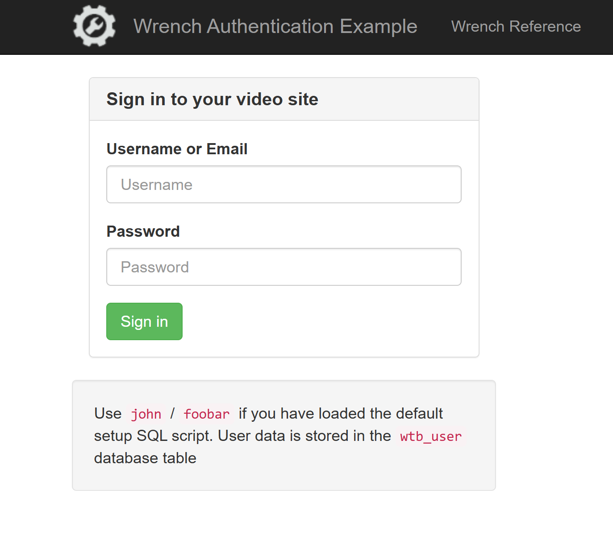
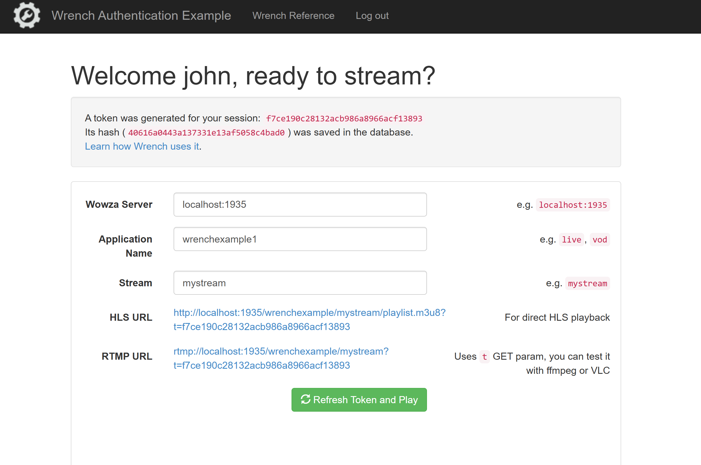

streamtoolbox-examples
=====================

Examples for the plugins on [Streamtoolbox.com](https://streamtoolbox.com) that help seamless integration between Wowza Streaming Engine&reg; and your own video streaming system.

- [Wrench](https://streamtoolbox.com/wrench): provides flexible authentication, authorization mechanisms for both your stream consumers and producers. Provides pay-per-minute and pay-per-view solutions and much more.
- [Scissor](https://streamtoolbox.com/scissor): API call driven playlist compilation, change between live streams and VOD content
- [Measure](https://streamtoolbox.com/measure): log player counts per stream, per streaming technology and per Wowza application using your own predefined SQL queries into your database

## Examples for Wrench

1. ~~Simple authentication with PHP frontend and MySQL database (`01-simple-authentication`)~~

Shows how we did things a decade ago, kept here for reference only. Functionally equivalent
to `02-auth-with-php-mysql`

2. [Authentication with PHP webapp and MySQL database (`02-auth-with-php-mysql`)](./wrench/02-auth-with-php-mysql/)

Minimal video site (PHP backend, HTML+JS frontend) that uses a MySQL database for storing users. Once the user logs in, a token is dynamically generated and stored in the database. This token is then put into video links so that Wrench can authenticate the user. All connections without a valid token are refused, a predefined
token is required for publishing a demo stream.

 
