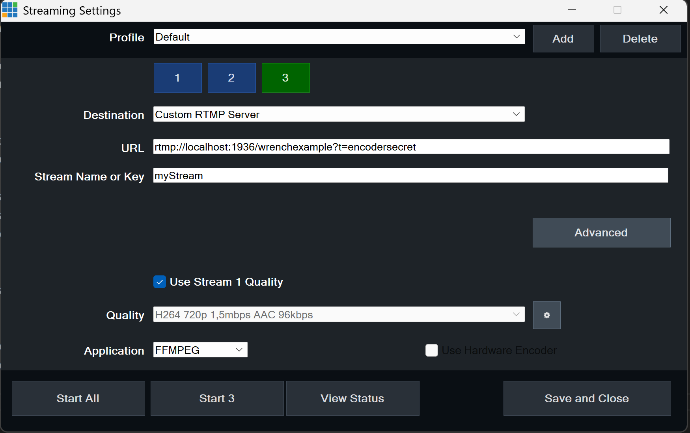
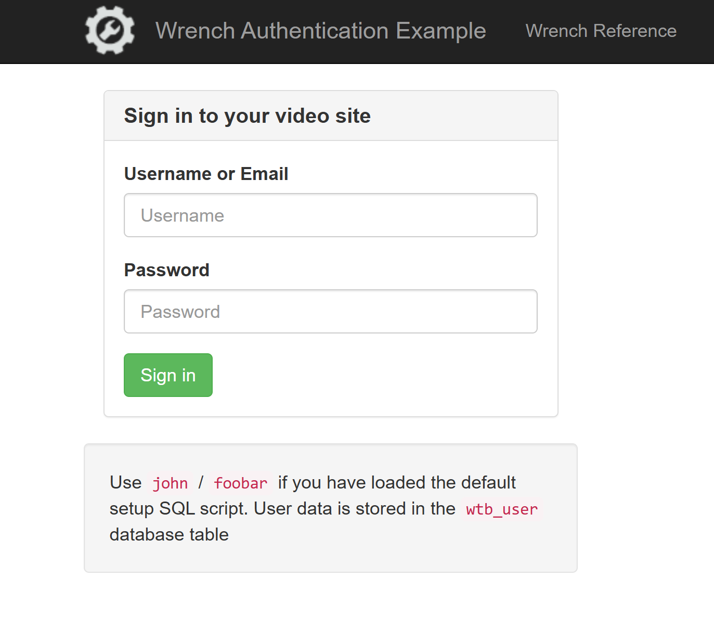
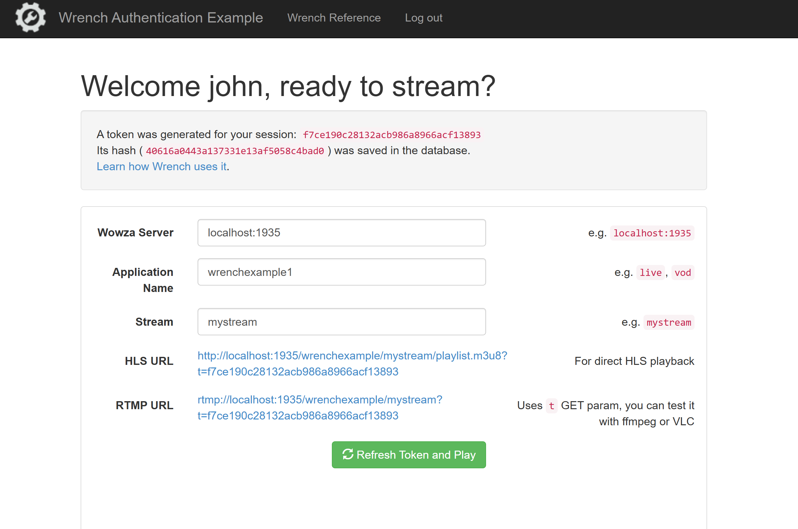

## Simple authentication

This example uses docker compose to set up a MySQL database where
stream tokens and users are stored and a second container that
runs the minimal PHP application that performs user login and hosts
the video player.

### Usage

This example assumes you have `docker` installed on your computer.

    $ docker compose up --build

This starts the two containers and you can access the login app
on port 8090 immediately. MySQL is going to be accessible on port 3306 and the initialization you can see in `dbinit/setup.sql` will create the database, a user and the necessary tables in it.

You need to install Wowza Streaming Engine and Wrench module
separately by following the instructions on https://streamtoolbox.com/wrench-reference

You can find a preconfigured Wowza `Application.xml` file under the `wowza` folder
that you can copy into your Wowza installation immediately. This file contains
the SQL queries and settings that match this example.

Define a Wowza application called `wrenchexample` by simple creating an empty folder
and then copy the configuration into the related config folder:

    $ mkdir /usr/local/WowzaStreamingEngine/applications/wrenchexample
    $ mkdir /usr/local/WowzaStreamingEngine/conf/wrenchexample
    $ cp wowza/Application.xml /usr/local/WowzaStreamingEngine/conf/wrenchexample

You need to publish a stream into Wowza from your favourite encoder, such as vMix or OBS
and log into the example web application to be able to play back the stream.

When publishing the test stream, you need to pass a token to allow your connection, otherwise
Wrench will deny the request from the encoder. You can do this in vMix by specifying the
token in the URL field (and do similarly in other broadcaster software)

**Note**: On Windows the port 1935 might be occupied by WSL used behind the scenes by Docker Desktop.
This results in Wowza not being able to bind to port 1935. The simplest solution is to change
the port used for RTMP streaming to 1936, which you can do by editing the `conf/VHost.xml` file.
In this case please also change the port in the example application and your encoder software accordingly.

 
